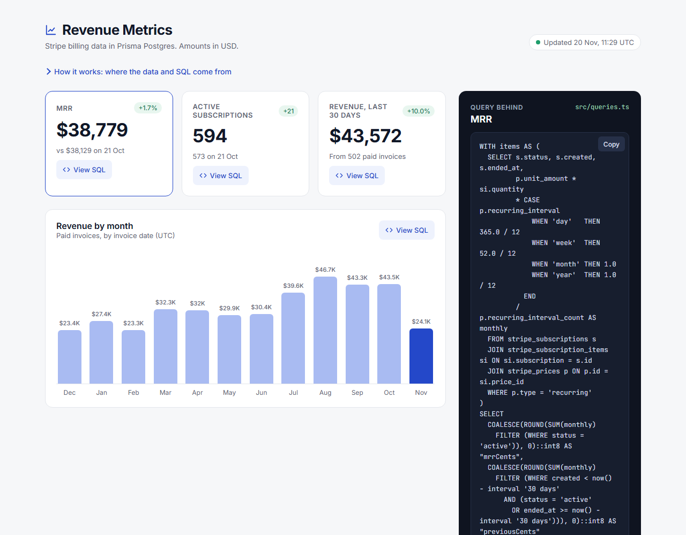

# Revenue Metrics with Prisma

A small dashboard of SaaS revenue metrics: MRR, active subscriptions, revenue in the last 30 days and revenue by month, from Stripe billing tables. Every metric is one SQL query, computed in Postgres and typed end to end with Prisma ORM 8, and the page shows you each query next to its result.

- **[Prisma ORM](https://www.prisma.io/orm)** 8 for the contract, the migration and typed raw SQL.
- **[Prisma Postgres](https://www.prisma.io/postgres)** for the data, with demo data on the first visit.
- **[Prisma Compute](https://www.prisma.io/compute)** to host it, declared with Prisma Composer.

<a href="https://console.prisma.io/apps/revenue-metrics"></a>



## What it shows

| Card | What it is | Reads |
| --- | --- | --- |
| **MRR** | Monthly recurring revenue of active subscriptions. Each price is turned into a monthly amount (a yearly price is divided by 12) and multiplied by its quantity. | `stripe_subscriptions`, `stripe_subscription_items`, `stripe_prices` |
| **Active subscriptions** | Subscriptions with status `active`. `trialing` and `past_due` are left out. | `stripe_subscriptions` |
| **Revenue, last 30 days** | Cash from paid invoices created in the last 30 days. | `stripe_invoices` |
| **Revenue by month** | Paid invoices of the last 12 months, grouped by month in UTC. A month with no invoices shows as $0. | `stripe_invoices` |

Each card also shows its change from 30 days earlier, from a second column of the same query. **View SQL** opens the query behind a card in the side panel, with the `.returnsRow()` spec that types it; **Copy** copies the SQL, which runs as is in any SQL client connected to the database. The panel text comes from `db.toSql()`, so it is the SQL that ran, not a copy of it.

Good to know:

- **Amounts are in cents**, as Stripe stores them, and the template assumes one currency (USD in the demo data). The queries do not convert or filter currencies.
- **The previous MRR and subscription counts are approximate.** A subscription counts as active 30 days ago if it was created before then and is active now or has ended since, and MRR uses today's prices. Revenue's previous value is exact.
- **Invoices are dated by `created`.** Stripe's paid date is only inside the `data` JSON column, and subscription invoices are usually paid within about an hour of creation.
- **Results are cached for 60 seconds**, because Prisma Postgres bills per query and the page runs four of them. The page reads the database at request time, never during the build.

## Run it locally

You need **Node.js 22.18 or newer** (`.nvmrc` selects Node 24 for `nvm use`), **[Bun](https://bun.sh)**, and a PostgreSQL database. For Prisma Postgres, create a database in the [Prisma Console](https://console.prisma.io) and copy its connection string.

```bash
bun install
cp .env.example .env.local     # then set DATABASE_URL in .env.local
bun run contract:emit
bun run db:migrate             # creates the four Stripe tables
bun run db:seed                # adds the demo data (optional: the first visit does it)
bun run dev
```

- **Use `.env.local`, not `.env`:** `next build` copies `.env` into the bundle that a deploy uploads.
- **Prisma Postgres: use the direct host `db.prisma.io`.** If your connection string has `pooled.db.prisma.io`, change it to `db.prisma.io`. The pooled host refuses a setting Prisma ORM 8 sends while connecting, and commands fail with `Failed to connect to upstream database` ([prisma/orm#31081](https://github.com/prisma/orm/pull/31081)).

Open [http://localhost:3000](http://localhost:3000). You see the three cards and the chart with about a year of demo data: around 600 active subscriptions and $39k MRR. Click **View SQL** on any card to see its query and types in the side panel, and open **How it works** under the title for where the data and the queries come from.

## Deploy to Prisma Compute

The **Deploy with Prisma** button above copies this template to your GitHub account and deploys the copy with its own Prisma Postgres database. The first visit fills the empty database with the demo data.

To deploy from your machine instead:

```bash
bunx prisma auth login          # once; opens the browser
bun run deploy                  # next build, then prisma deploy
```

A deploy creates the Prisma project `revenue-metrics` (named after the module in `module.ts`) if it does not exist, provisions a Prisma Postgres database, applies the migration in `migrations/`, deploys the app and prints its URL.

- **Region:** the first deploy creates the project in `us-east-1`. To use another region, change `prismaCloud({ region })` in `prisma.config.ts` **before** the first deploy.
- **Windows:** use `bun run deploy`. `bunx prisma deploy` fails on Windows, because the deploy engine relaunches itself through `bunx.exe`.
- **Deploy on push:** connect the repository once with `bunx prisma git connect`. The included workflow (`.github/workflows/prisma-deploy.yml`) then deploys the default branch on every push.

## Use your real Stripe data

The four tables have the same columns, types and nulls as the Stripe tables that [Codeless Sync](https://codelesssync.com) creates, so you can sync your Stripe account into them and the dashboard shows your real numbers. Prisma's guide walks through it: [Codeless Sync with Prisma Postgres](https://www.prisma.io/docs/guides/integrations/codeless-sync). Sync the Subscriptions, Subscription Items, Prices and Invoices templates.

The demo rows all have ids containing `_seed_`, and synced rows never do, so the two never collide. To remove the demo data once your own data is in:

```bash
bun run db:seed --remove
```

## What this teaches

Read the files in this order:

1. **`src/prisma/contract.prisma`:** the four tables, written in PSL. `bun run contract:emit` writes `contract.json` and `contract.d.ts`, which type every query. [Author in PSL](https://www.prisma.io/docs/orm/contract-authoring/psl-syntax)
2. **`migrations/`:** the migration `bun run migration:plan` made from the contract, applied by `bun run db:migrate` and by every deploy. [How migrations work](https://www.prisma.io/docs/orm/migrations/how-migrations-work)
3. **`src/queries.ts`:** the four metrics as `db.raw.sql` statements with `.returnsRow()`. The comments explain codecs and why every value is cast in SQL. [Raw queries](https://www.prisma.io/docs/orm/reference/raw-queries)
4. **`src/prisma/seed.ts`:** the demo data, written with the ORM client (`createAll`, `deleteAll`) inside a transaction. [Transactions](https://www.prisma.io/docs/orm/fundamentals/transactions)
5. **`src/app/page.tsx`:** runs the queries at request time and caches the results for 60 seconds with [`unstable_cache`](https://nextjs.org/docs/app/api-reference/functions/unstable_cache). `dashboard.tsx` is the only client component.
6. **`module.ts` and `src/service.ts`:** the app and its database, declared for Prisma Composer, which provisions and connects them on deploy. [Apps and modules](https://www.prisma.io/docs/composer/apps-and-modules)

### Try it: add a churn card

Add a fifth query to `src/queries.ts`: the subscriptions that were active 30 days ago, and how many of them have ended since.

```sql
SELECT
  count(*) FILTER (WHERE created < now() - interval '30 days'
    AND ended_at >= now() - interval '30 days')::int4 AS "churned",
  count(*) FILTER (WHERE created < now() - interval '30 days'
    AND (status = 'active'
      OR ended_at >= now() - interval '30 days'))::int4 AS "activeBefore"
FROM stripe_subscriptions
```

Type it with `.returnsRow({ churned: 'pg/int4@1', activeBefore: 'pg/int4@1' })`, add it to `loadDashboard()`, and show `churned / activeBefore` as a percentage in a new card in `page.tsx`. TypeScript tells you everywhere the new metric needs to go.

## Scripts

| Command | What it does |
| --- | --- |
| `bun run dev` | Next.js dev server on [http://localhost:3000](http://localhost:3000). |
| `bun run build` | Emits the contract, then builds the app. Needs no database. |
| `bun run typecheck` | Type-checks the project. |
| `bun run contract:emit` | Writes `contract.json` and `contract.d.ts` from `contract.prisma`. |
| `bun run migration:plan --name <name>` | Plans a migration from contract changes. |
| `bun run db:migrate` | Applies the migrations to the database in `DATABASE_URL`. |
| `bun run db:seed` | Replaces the demo rows with a fresh set. `--remove` deletes them. |
| `bun run deploy` | Builds, then deploys to Prisma Compute. |

## Project layout

```text
src/
  app/
    page.tsx            server component: loads, caches and formats the metrics
    dashboard.tsx       client component: cards, chart and SQL panel
    layout.tsx          fonts and page title
    globals.css         styles
  prisma/
    contract.prisma     the four Stripe tables
    db.ts               the database client (Composer on Compute, DATABASE_URL locally)
    seed.ts             demo data and first-visit seeding
    seed-cli.ts         bun run db:seed
  queries.ts            the four metric queries
  service.ts            the Compute service
migrations/             the planned migration, applied by every deploy
module.ts               the app for Prisma Composer: a database and the service
```
